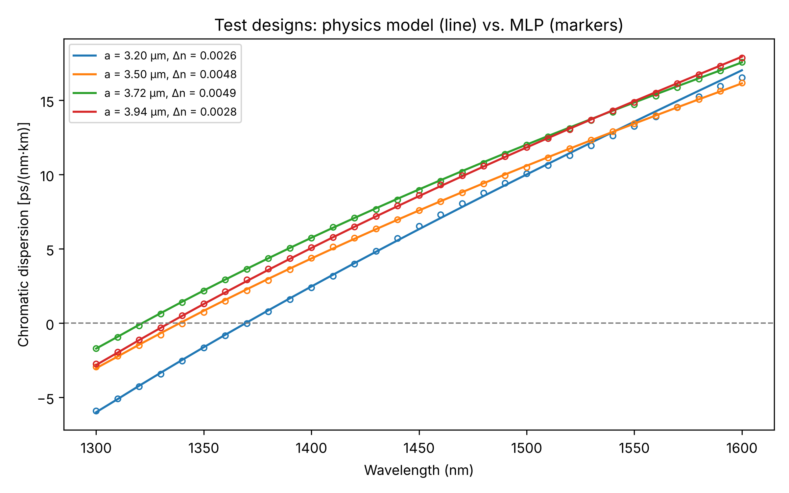

# Photonics Musings

This is where I keep my personal explorations and computational projects in photonics, numerical modelling, and machine learning.

## Projects

### Machine Learning-Based Prediction of Fibre Chromatic Dispersion

In this project I explored how well a neural network can predict chromatic dispersion from a fibre's design parameters. I started by building a physics-based step-index fibre model that solves for the fundamental LP01 mode and uses the Sellmeier equation for the refractive index of silica. I then used that model to generate the data: 300 fibre designs, each evaluated at 31 wavelengths between 1300 and 1600 nm. Finally, I trained a multilayer perceptron (MLP) to predict dispersion from core radius, index difference, and wavelength.

I split the data by fibre design, so the 30 test fibres are ones the network never saw at any wavelength. They come from the same parameter ranges as the training fibres, which means the test checks interpolation within the range I sampled, not extrapolation beyond it.

**Test Performance**

On the 30 held-out designs (930 samples), the MLP reached an R² of 0.999854 and an MAE of 0.0541 ps/(nm·km) against the physics-model values. These numbers show how closely the network matches my own physics model. They are not a comparison with experimental measurements.

The plot below shows the physics-model curves (lines) and the MLP predictions (markers) for four of the test designs.

**Project repository:** [Fibre Dispersion Prediction Using Machine Learning](fibre-dispersion-ml/)

## Libraries & Tools

**Programming Language:** Python

**Libraries:** NumPy, SciPy, pandas, scikit-learn, Matplotlib, joblib
