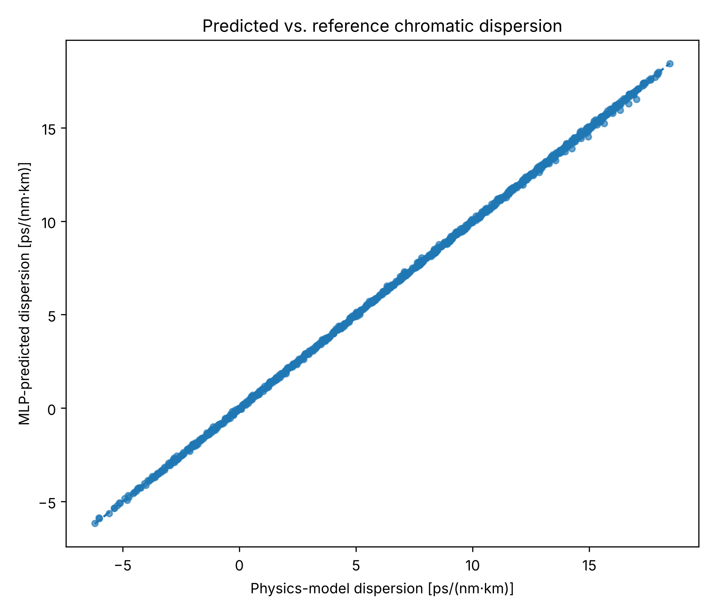
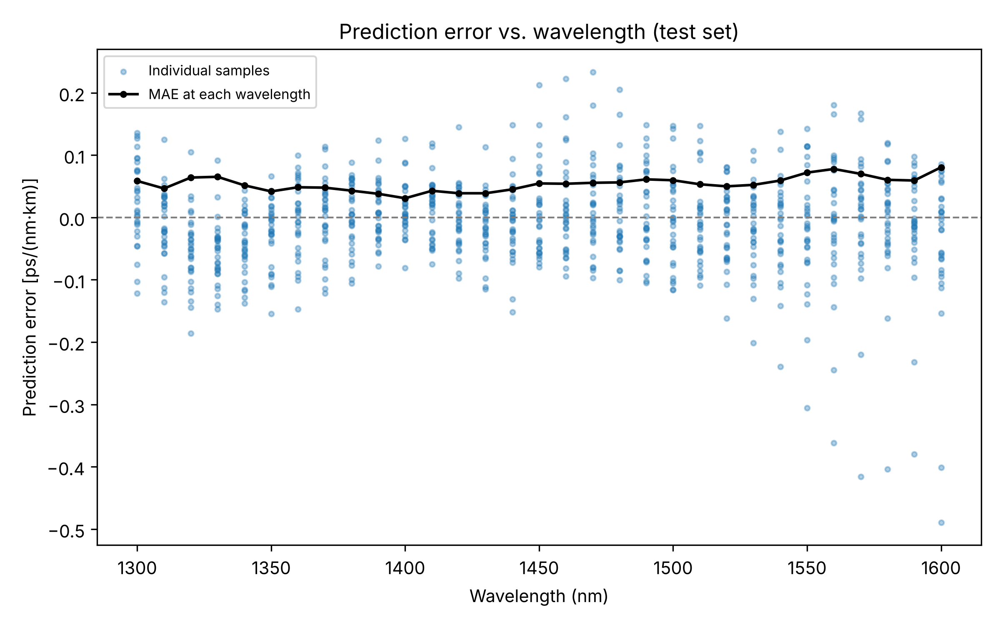

# Fibre Dispersion Prediction Using Machine Learning

Python implementation of a physics-based step-index fibre model and an MLP regression model for chromatic-dispersion prediction.

## Files

- `src/fibre_model.py`: Sellmeier index, LP01 solution, effective index and dispersion.
- `src/dataset.py`: fibre design generation, labelled dataset creation and design-wise split.
- `src/train_model.py`: feature/target standardisation and MLP training.
- `src/evaluate_model.py`: held-out test metrics and test-set plots.
- `src/plot_dispersion.py`: physics-model dispersion curve.
- `requirements.txt`: dependencies.
- `requirements-tested.txt`: exact versions used to generate the results.

## Parameters

Core radius: 3.2–4.0 µm; core–cladding index difference: 0.0025–0.0050; wavelength: 1300–1600 nm (31 points).

The dataset contains 300 fibre designs and 9,300 samples. The split is by design: 240 training, 30 validation and 30 test designs. The validation designs are held out but not used for training or model selection; early stopping uses a random 15% of the training rows.

The test designs come from the same sampled range as the training designs, so the evaluation measures interpolation within that range.

## Run from the project root

```bash
python -m pip install -r requirements.txt   # or requirements-tested.txt for exact versions
python src/dataset.py
python src/plot_dispersion.py
python src/train_model.py
python src/evaluate_model.py
```

Outputs:

| File | Content |
|---|---|
| `data/fibre_dispersion_dataset.csv` | Generated dataset (included for inspection; `dataset.py` recreates it) |
| `models/fibre_dispersion_mlp.joblib` | Trained MLP and scalers (not stored in the repository; created by `train_model.py`) |
| `results/physics_dispersion_curve.png` | Physics-model dispersion for one design (default a = 3.8 µm, Δn = 0.004) |
| `results/predicted_vs_reference.png` | MLP prediction against physics reference, test set |
| `results/test_design_curves.png` | Physics curve and MLP prediction for four test designs |
| `results/error_histogram.png` | Distribution of test-set prediction errors |
| `results/error_vs_wavelength.png` | Test-set errors and per-wavelength MAE |
| `results/test_predictions.csv` | Reference and predicted values for every test sample |

## Test performance

Evaluated on 30 held-out fibre designs (930 samples) with random seed 42:

| Metric | Result |
|---|---:|
| R² | 0.999854 |
| MAE | 0.0541 ps/(nm·km) |
| RMSE | 0.0745 ps/(nm·km) |

These values compare the MLP with physics-model reference values, not experimental measurements.

## Results






## Reproducibility

The exact original 300 design combinations were not available, so `dataset.py` samples designs uniformly at random with seed 42. All random steps (design sampling, data split, network initialisation) use this seed, and two separate runs of the commands above produced identical datasets, metrics and figures. The results were generated with Python 3.13, NumPy 2.5.3, SciPy 1.18.1, pandas 3.0.5, scikit-learn 1.9.1 and Matplotlib 3.11.2. Other library versions may change the last digits of the metrics.
