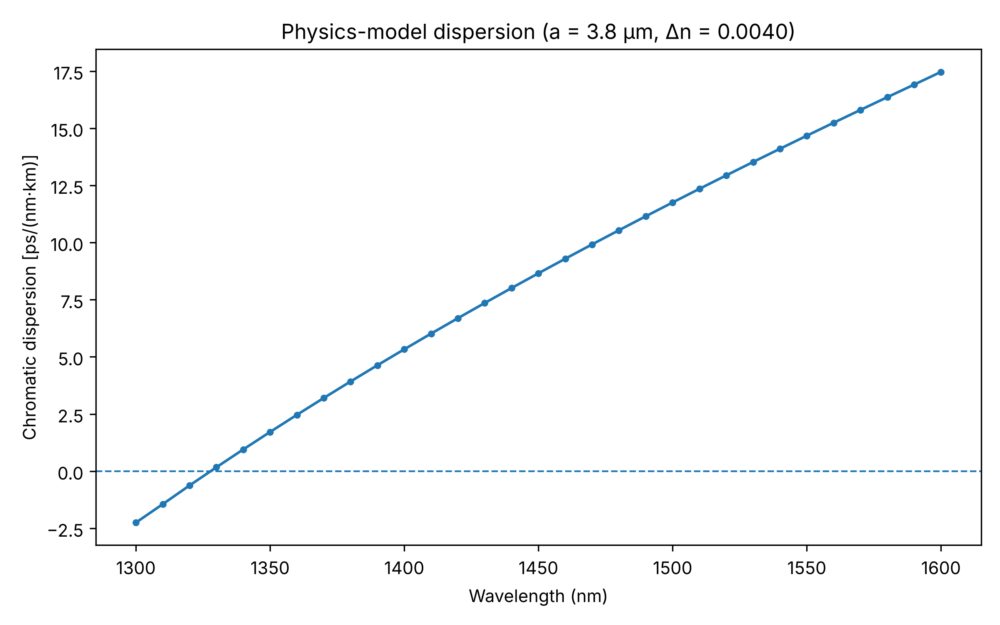
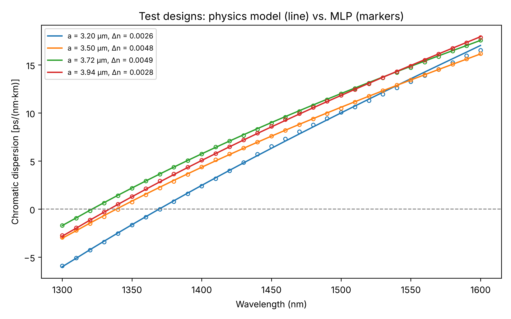
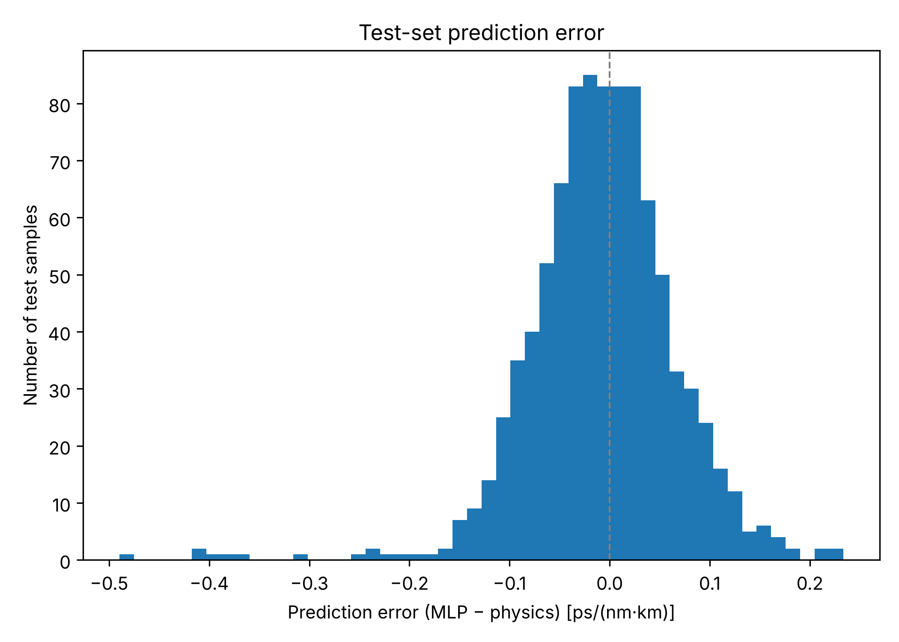

# Fibre Dispersion Prediction Using Machine Learning

Python implementation of a physics-based step-index fibre model and a multilayer perceptron (MLP) regression model for chromatic-dispersion prediction.

## Project Structure

- `src/fibre_model.py`: Sellmeier refractive index, LP01 mode solution, effective index and chromatic dispersion.
- `src/dataset.py`: Fibre design generation, dataset creation and design-wise data splitting.
- `src/train_model.py`: Feature and target standardisation, MLP training and model saving.
- `src/evaluate_model.py`: Held-out test evaluation, prediction metrics and error analysis plots.
- `src/plot_dispersion.py`: Physics-model dispersion curve generation.
- `data/`: Generated fibre dispersion dataset.
- `results/`: Dispersion plots, prediction comparisons and test-set predictions.
- `requirements.txt`: Python dependencies.
- `requirements-tested.txt`: Exact library versions used to generate the reported results.
- `.gitignore`: Excludes Python caches, virtual environments and the trained model file.

## Fibre Parameters and Dataset

The step-index fibre model considers the following parameter ranges:

- Core radius: 3.2–4.0 µm
- Core–cladding refractive-index difference: 0.0025–0.0050
- Operating wavelength: 1300–1600 nm (31 wavelength points)

The model uses a scalar LP01 mode approximation with a constant core–cladding refractive-index difference. The wavelength dependence of the refractive indices is therefore introduced through the Sellmeier model for the cladding, with the core index derived from the specified index difference.

The dataset contains 300 distinct fibre designs, each evaluated at 31 wavelength points, giving 9,300 samples.

The data is split by fibre design into:

- Training: 240 designs (7,440 samples)
- Validation: 30 designs (930 samples)
- Test: 30 designs (930 samples)

The validation designs are held out and are not used for training or model selection. Early stopping instead uses a random 15% subset of the training rows.

The test designs are sampled from the same parameter ranges as the training designs. Therefore, the evaluation measures interpolation to unseen fibre designs within the sampled parameter space, rather than extrapolation beyond it.

## Running the Project

Run the following commands from the project root directory.

```bash
python -m pip install -r requirements.txt

python src/dataset.py
python src/plot_dispersion.py
python src/train_model.py
python src/evaluate_model.py
```

To install the exact tested library versions instead, use:

```bash
python -m pip install -r requirements-tested.txt
```

## Generated Outputs

| File | Description |
|---|---|
| `data/fibre_dispersion_dataset.csv` | Generated dataset containing fibre parameters and reference dispersion values. Included in the repository and regenerated by `dataset.py`. |
| `models/fibre_dispersion_mlp.joblib` | Trained MLP and fitted scalers. Generated by `train_model.py`; not stored in the repository. |
| `results/physics_model_dispersion_curves.png` | Physics-model dispersion curve for one fibre design (default: a = 3.8 µm, Δn = 0.004). |
| `results/predicted_vs_reference_dispersion.png` | Comparison of MLP predictions against physics-model reference values for the test set. |
| `results/test_fibre_design_dispersion_comparison.png` | Dispersion curves comparing physics-model values and MLP predictions for four test designs spread across the core-radius range. |
| `results/dispersion_prediction_error_distribution.png` | Distribution of test-set prediction errors. |
| `results/dispersion_prediction_error_vs_wavelength.png` | Test-set prediction errors and mean absolute error across wavelengths. |
| `results/test_set_predictions.csv` | Reference and predicted dispersion values for every test sample. |

## Test Performance

Evaluated on 30 held-out fibre designs (930 samples) using random seed 42.

| Metric | Result |
|---|---:|
| R² | 0.999854 |
| MAE | 0.0541 ps/(nm·km) |
| RMSE | 0.0745 ps/(nm·km) |

These metrics quantify agreement between the MLP predictions and the physics-based model. They do not represent validation against experimental measurements.

## Results

**Physics-model dispersion**



**Dispersion curves for test designs**



**Predicted versus reference dispersion**


**Prediction error across wavelength**


**Distribution of prediction errors**



## Reproducibility

The exact original 300 fibre design combinations were not available. Therefore, `dataset.py` generates 300 designs by uniform random sampling with seed 42.

All random steps, including design sampling, data splitting and network initialisation, use this seed. Two independent runs of the project produced identical datasets, predictions, metrics and figures.

The reported results were generated using:

| Software | Version |
|---|---|
| Python | 3.13 |
| NumPy | 2.5.3 |
| SciPy | 1.18.1 |
| pandas | 3.0.5 |
| scikit-learn | 1.9.1 |
| Matplotlib | 3.11.2 |
| joblib | 1.6.0 |

